<!-- Animated header -->

  

<!-- New typing text (different from the common ones) -->

  

  
  
  

<!-- Animated terminal box -->

  

<h2 align="center"><b>🎮 PAC-MAN CONTRIBUTION GRAPH</b></h2>

  <picture>
    <source media="(prefers-color-scheme: dark)" srcset="https://raw.githubusercontent.com/jschtwntyfour/jschtwntyfour/output/pacman-contribution-graph-dark.svg">
    <source media="(prefers-color-scheme: light)" srcset="https://raw.githubusercontent.com/jschtwntyfour/jschtwntyfour/output/pacman-contribution-graph.svg">
    
  </picture>

<h2><b>👋 ABOUT ME</b></h2>

HI! I'm a **Cyber Security Enthusiast & Penetration Tester**.

I'm a continuous learner in my Cyber Security career. I enjoy playing **CTF** on platforms such as **PicoCTF**, **OverTheWire**, etc.

I also code using a few languages such as **HTML, CSS, JS, Python, and PHP**.

I'm looking forward to learning and working together with you guys!

<b>More about me</b>

 

- **Name:** Justyn Sachio Ho
- **School:** SMK Cinta Kasih Tzu Chi
- **Role:** Junior Penetration Tester / Cybersecurity Analyst
- **Currently:** Continuing to learn security fundamentals and CTF techniques

<h2 align="center"><b>⚔️ SECURITY TOOLKIT</b></h2>

<h2 align="center"><b>🚩 PLATFORMS</b></h2>

<h2 align="center"><b>💻 LANGUAGES</b></h2>

<h2 align="center"><b>🧩 FRAMEWORKS &amp; LIBRARIES</b></h2>

<h2 align="center"><b>🏗️ INFRASTRUCTURE, DESIGN &amp; ENVIRONMENT</b></h2>

<h2 align="center"><b>📊 ACTIVITY</b></h2>

  
  

  

  

  

